# House Modes & Alarm Center

> **Current build: v2026.10.29.32** · based on Alarmo 1.10.19 · full history in [CHANGELOG.md](CHANGELOG.md)

A Home Assistant alarm integration built on [Alarmo](https://github.com/nielsfaber/alarmo) by Niels Faber: one place for
**House Modes**, alarm **partitions and zones**, a **physical alarm panel** (Honeywell/Ademco Vista or DSC via
Envisalink), **users and Z-Wave lock codes**, and an **activity log** of everything that happens.

> **Status: test build.** It still uses Alarmo's domain (`alarmo`), so it **replaces** Alarmo when installed
> (it cannot run next to it) and reads Alarmo's existing configuration. A rename to its own domain, with a one-time
> import, is planned. Your `alarmo.storage` stays loadable by upstream Alarmo until then — see
> [INSTALL-EXT.md](INSTALL-EXT.md) for rolling back.

## Screenshots

Rendered from a demo house (made-up names) — see *Development* for how they are made.

<!-- SCREENSHOTS:START -->
<table>
  <tr>
    <td align="center" valign="top" width="50%">
      <a href="screenshots/01-house-modes.png">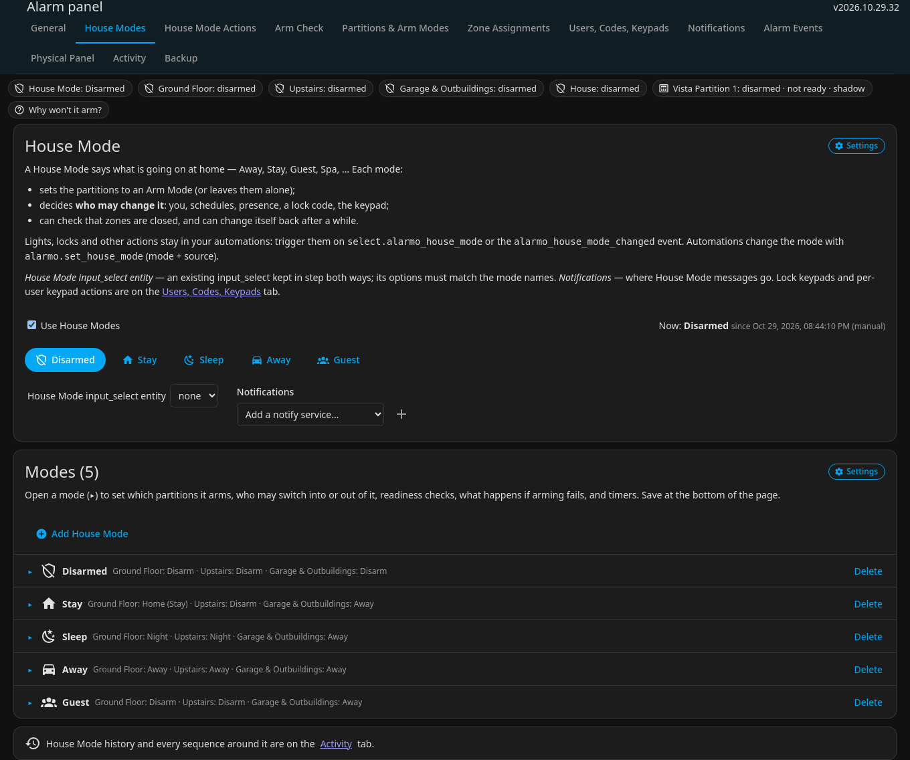</a> House modes
    </td>
    <td align="center" valign="top" width="50%">
      <a href="screenshots/02-house-mode-actions.png">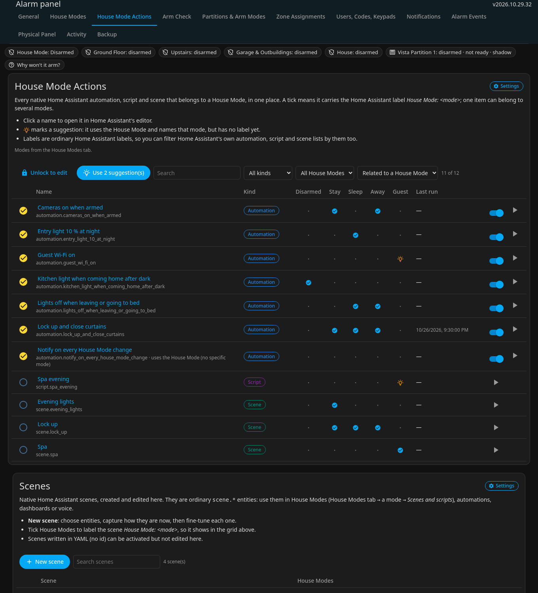</a> House mode actions
    </td>
  </tr>
  <tr>
    <td align="center" valign="top" width="50%">
      <a href="screenshots/03-scenes.png">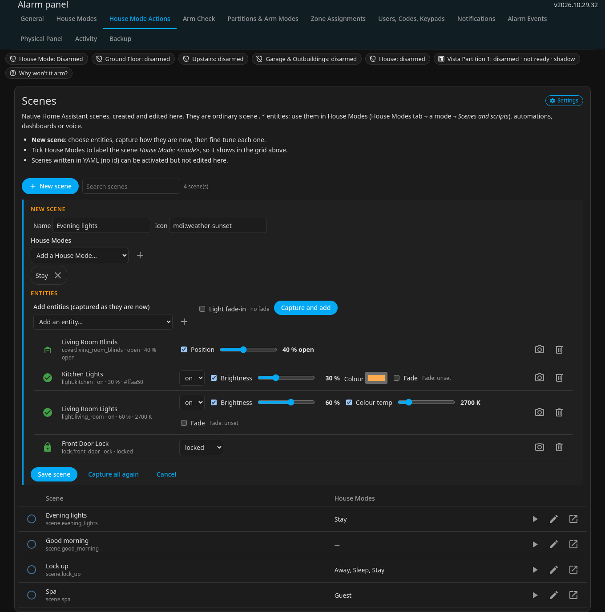</a> Scenes
    </td>
    <td align="center" valign="top" width="50%">
      <a href="screenshots/04-zone-assignments.png">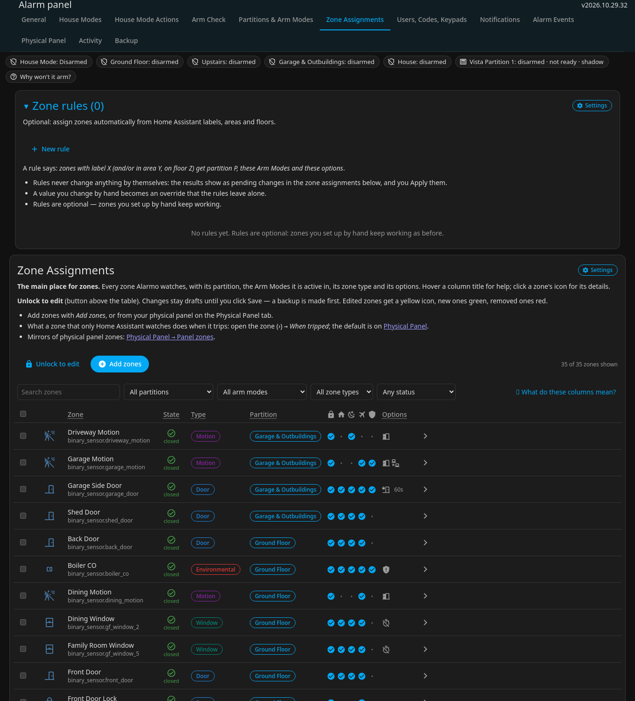</a> Zone assignments
    </td>
  </tr>
  <tr>
    <td align="center" valign="top" width="50%">
      <a href="screenshots/05-zone-editor.png">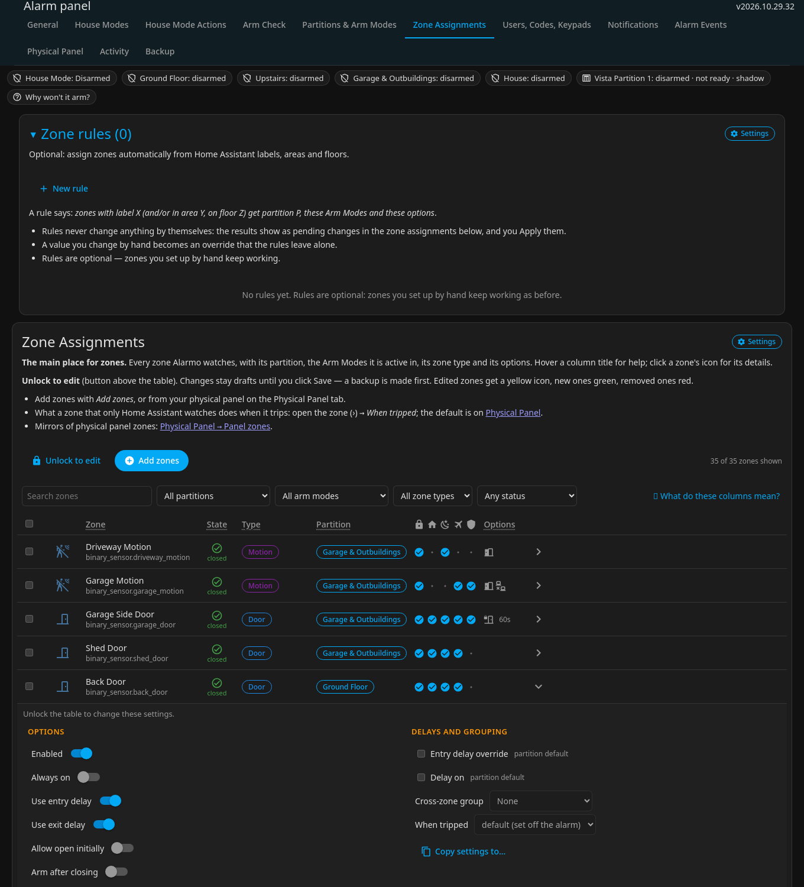</a> Zone editor
    </td>
    <td align="center" valign="top" width="50%">
      <a href="screenshots/06-physical-panel.png">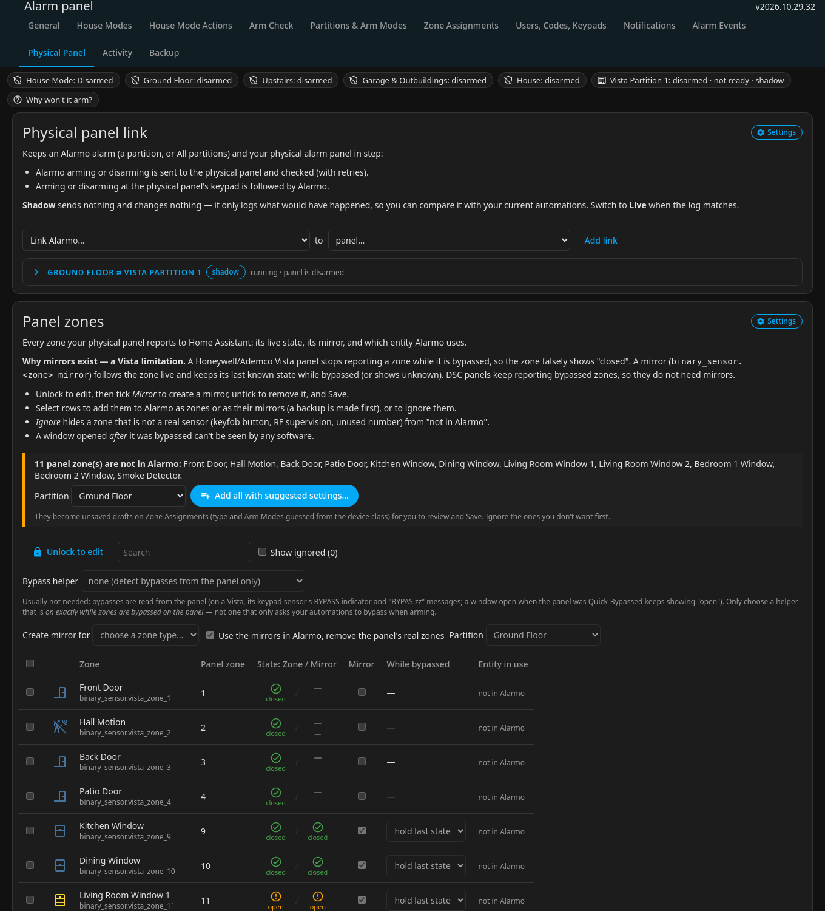</a> Physical panel
    </td>
  </tr>
  <tr>
    <td align="center" valign="top" width="50%">
      <a href="screenshots/07-users-codes-keypads.png">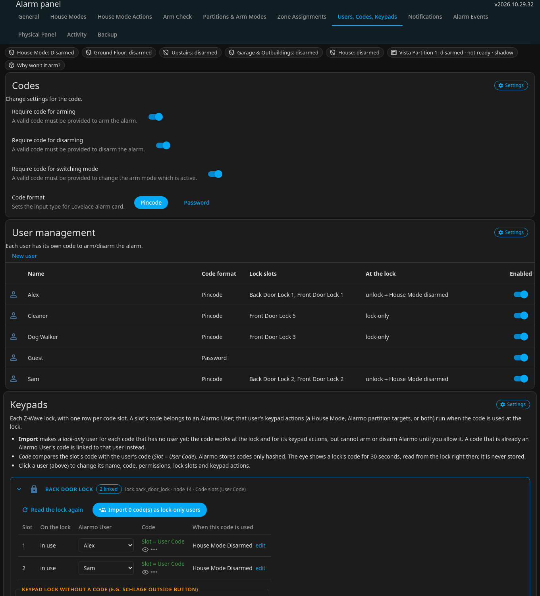</a> Users codes keypads
    </td>
    <td align="center" valign="top" width="50%">
      <a href="screenshots/08-arm-check.png">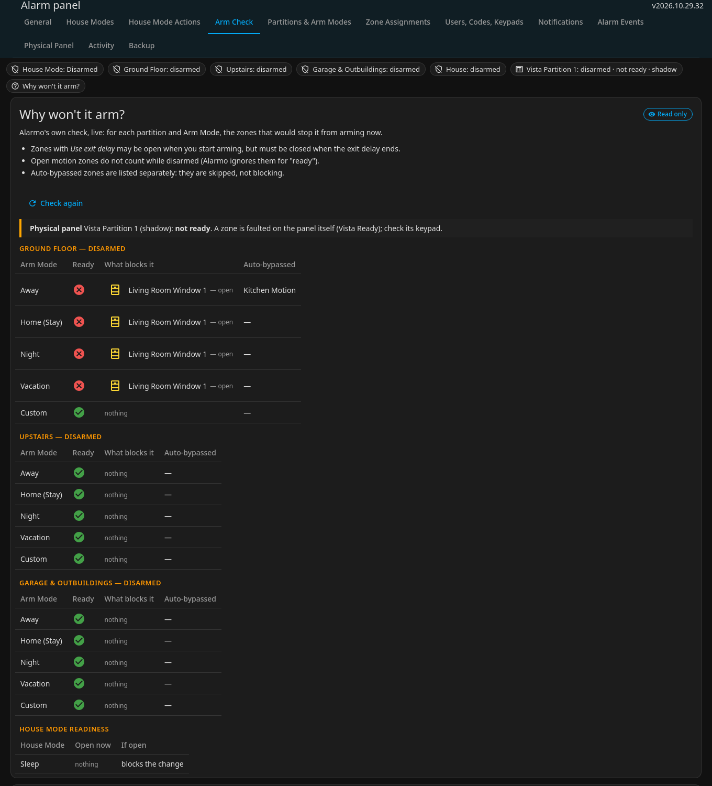</a> Arm check
    </td>
  </tr>
  <tr>
    <td align="center" valign="top" width="50%">
      <a href="screenshots/09-activity.png">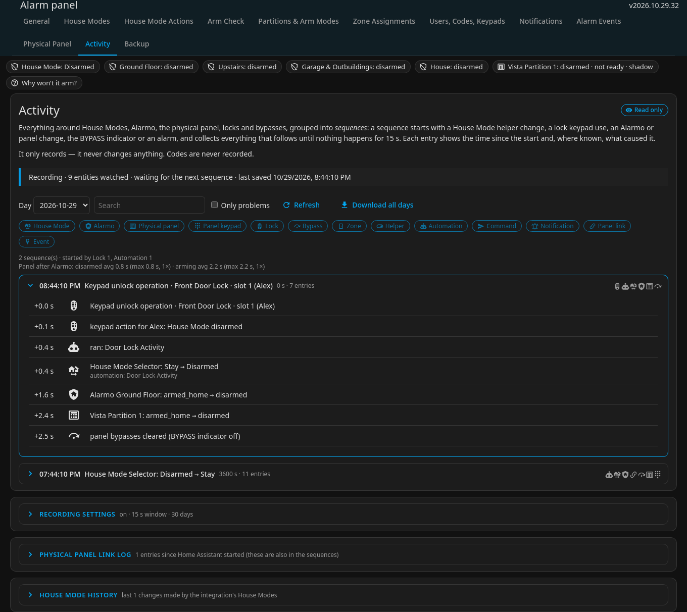</a> Activity
    </td>
    <td align="center" valign="top" width="50%">
      <a href="screenshots/10-backup.png">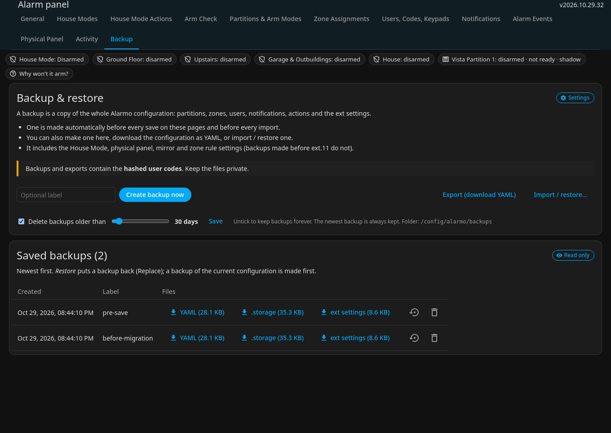</a> Backup
    </td>
  </tr>
  <tr>
    <td align="center" valign="top" width="50%">
      <a href="screenshots/11-alarm-events-migrate.png">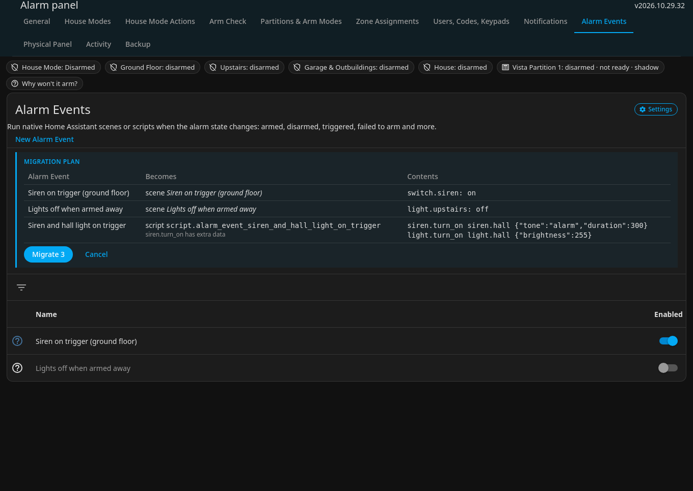</a> Alarm events migrate
    </td>
    <td></td>
  </tr>
</table>
<!-- SCREENSHOTS:END -->

## What it adds to Alarmo

**House Modes** — Away, Stay, Sleep, Guest, Spa, … ([HOUSE-MODES.md](HOUSE-MODES.md))
- Each mode sets partitions to an Arm Mode (or leaves them), decides **who may change it** (manual, automations,
  schedule, presence, a lock code, the panel keypad), can check zones are closed and change itself back on a timer.
- `select.alarmo_house_mode`, the `alarmo.set_house_mode` service, events, two blueprints, an optional `input_select`
  kept in step.

**Physical panel link** (Envisalink; other panels via HA services)
- **Shadow mode** first: logs what it would do next to your own automations; **live** when the log matches.
- **Panel-led arming:** Alarmo checks every zone, the panel gets the command at once, Alarmo counts as armed when the
  panel is — one exit delay. Retries, failure policy, learned exit delays and *Match Alarmo's exit times*.
- **Arming at the panel keypad** is followed from the start (mode read from the keypad text, mapping per mode); zones
  only Home Assistant watches are bypassed and you are told.
- What happens when a zone the panel does not watch trips: set off the panel (siren, relay, panic key) or notify.

**Panel zones and mirrors**
- Every panel zone with live state, *add to Alarmo*, *ignore*, and **mirrors**: a copy of a zone that keeps its last
  state while the zone is bypassed — a **Vista** stops reporting bypassed zones (DSC does not need mirrors).
- Vista bypasses are read from the panel itself (BYPASS indicator and the "BYPAS zz" keypad list), across restarts.

**Zones** (Zone Assignments)
- One table with drafts (edit many, review, save once), lock/unlock, live state, *Copy settings to…*, bulk changes.
- **Zone rules:** assign zones from HA labels, areas and floors, with per-zone overrides.
- Garage doors (covers) and locks as zones; per-zone *When tripped* for zones only HA watches.

**Users, Codes, Keypads**
- One Alarmo User per person: what the code may do in Alarmo (arm and disarm / arm only / lock only), partitions.
- **Z-Wave lock code slots** linked to users: import a lock's codes as users, check *Slot = User Code*, write a user's
  code to its slots, show a slot's code for 30 s (admin only, never stored). Codes are stored only hashed.
- **Keypad actions per user:** when the code unlocks (or keypad-locks) a lock → a House Mode and/or partition targets.

**Arm Check** — *Why won't it arm?* (Alarmo's own check, live, per partition and Arm Mode, plus the panel's Ready) and
a **walk test**.

**Activity** — a recorder of sequences: House Mode helpers, Alarmo, the panel and its keypad text, locks, bypasses,
mirrors, automations that ran (as the *cause*), commands and notifications, grouped from the trigger until things go
quiet. Daily files, filters, download, a summary with panel timings. Only observes; never records codes.

**Housekeeping** — date-stamped backups (configuration + ext settings) with retention, YAML export/import with a
preview, a status strip on every page, pages laid out to one design.

## Install

**HACS (custom repository)**

1. Remove upstream Alarmo from HACS first if it is installed (*HACS → Alarmo → Remove*; do **not** delete the Alarmo
   integration under *Settings → Devices & services* — that wipes Alarmo's configuration). Both use
   `custom_components/alarmo`.
2. *HACS → ⋮ → Custom repositories* → `Ltek/house-modes-alarm-center`, type **Integration** → download.
3. Restart Home Assistant and reload the browser. The existing Alarmo configuration is used as it is.

**Manual:** copy `custom_components/alarmo` from a release ZIP over `/config/custom_components/alarmo` and restart.

Before either: make a rollback copy ([INSTALL-EXT.md](INSTALL-EXT.md) § 1). Moving from several partitions to one, or
from template mirrors: [MIGRATION.md](MIGRATION.md).

## Documentation

| | |
|---|---|
| [HOUSE-MODES.md](HOUSE-MODES.md) | House Modes, sources, timers, lock codes and keypad actions |
| [INSTALL-EXT.md](INSTALL-EXT.md) | Install, checks per build, backups, rolling back to upstream Alarmo |
| [MIGRATION.md](MIGRATION.md) | From partitions-per-device to one partition; replacing template mirrors |
| [CHANGELOG.md](CHANGELOG.md) | Every build |
| [docs/ALARMO-README.md](docs/ALARMO-README.md) | Upstream Alarmo reference: entity, states, services, events, MQTT, card |

## Development

- Python: `uv run pytest -q`, `uv run ruff check custom_components/alarmo tests tools`.
- Frontend (`custom_components/alarmo/frontend`): `npm ci`, `npm run build`, `npm test`.
- Build a release: write the `## v<version>` CHANGELOG entry (`bash tools/package.sh --print` shows the next version,
  `YYYY.MM.DD.BUILD`), then `bash tools/package.sh` (version bump, build, tests, ZIP in `release/`).
- Screenshots (demo data, no real house): `ALARMO_SCREENSHOT_DEMO=1 uv run pytest -q tests/test_screenshot_demo.py`
  then `node tools/screenshots/capture.mjs` (needs `playwright-core` and Chromium) → `screenshots/*.png`. Pushing
  them runs the *Update Screenshot Grid* workflow, which rebuilds the gallery above.
- `upstream` remote: [nielsfaber/alarmo](https://github.com/nielsfaber/alarmo) (base commit `47b31a6`). Upstream is not
  merged any more; files may differ freely.

## Credits and licence

Based on [Alarmo](https://github.com/nielsfaber/alarmo) © Niels Faber and contributors, licensed under the
[Apache License 2.0](LICENSE). This build is modified extensively; the changes are listed in [CHANGELOG.md](CHANGELOG.md).
Alarmo's issue tracker is for upstream Alarmo only — please do not report problems with this build there.
